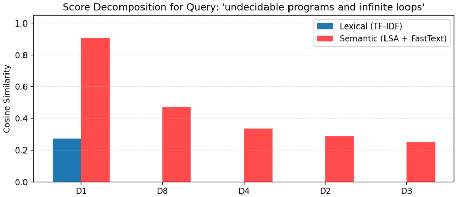

# Hybrid Semantic & Lexical Search Engine

A lightweight Information Retrieval engine in Python & Streamlit that fuses **Sparse Lexical Search (TF-IDF)** with **Dense Semantic Embeddings (LSA + FastText)** to retrieve relevant documents even when queries share zero exact keywords with the corpus.

## Architecture & Features
- **Sparse Lexical Retrieval:** TF-IDF vectorization with English stop-word filtering for exact keyword precision.
- **Dense Semantic Retrieval:** Combines Truncated SVD (Latent Semantic Analysis) with character n-gram FastText embeddings (`min_n=2, max_n=4`) to handle synonyms, paraphrases, and out-of-vocabulary (OOV) terms.
- **Tunable Hybrid Score Fusion:** Interactive $\alpha \in [0, 1]$ weighting ($\text{Score} = \alpha \cdot S_{\text{lexical}} + (1 - \alpha) \cdot S_{\text{semantic}}$) with visual score decomposition charts.

## Quickstart
```bash
pip install -r requirements.txt
streamlit run app.py
```

## Preview

